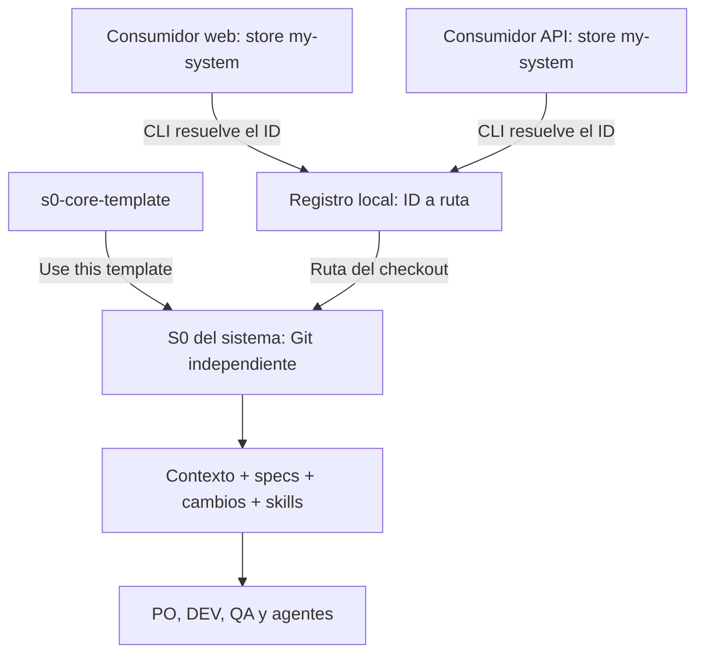
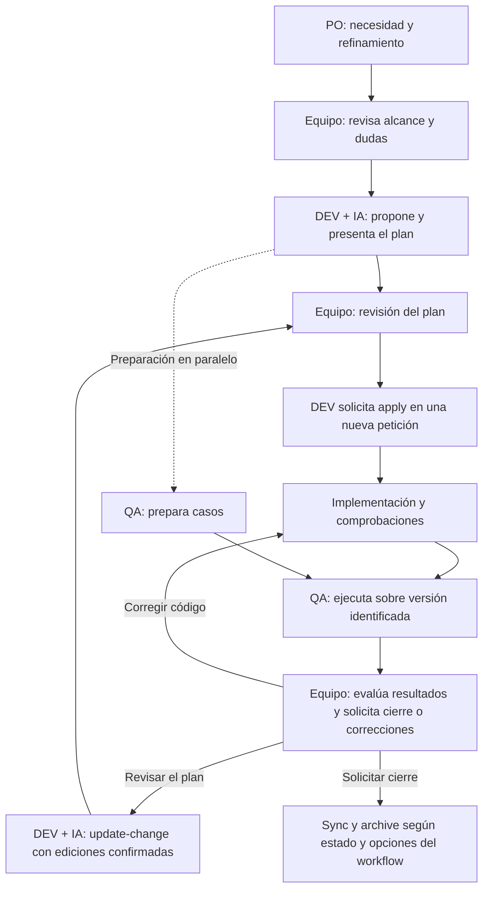

# S0 Core — descripción del estado actual

Este documento reúne el contexto técnico y funcional de S0 Core para una persona
o una IA que no haya participado en su desarrollo. Se puede compartir como un
único archivo para comprender el diseño, evaluar sus límites y discutir ideas.
Describe la plantilla; los datos de cada producto pertenecen a su propia instancia.

| Referencia | Valor |
| --- | --- |
| Fecha de revisión | 2026-10-25 |
| Repositorio maestro | `fdelvalle01/s0-core-template` |
| Revisión de implementación y documentación consultada | `a909e31d95470ab092564a8e7a89bb7d4701d5e2` |
| Versión declarada del núcleo | 0.2 |
| CLI comprobada por el proyecto | OpenSpec 1.14.3 |
| Schema utilizado | `spec-driven`, oficial de OpenSpec |

La revisión indicada es la base anterior a la incorporación de este resumen.
Los resultados de pruebas que se citan son evidencia documentada en esa base;
redactar este archivo no equivale a repetir las pruebas. Las secciones sobre
límites y preguntas abiertas distinguen capacidades actuales de posibles mejoras.

## 1. Propósito y decisiones principales

S0 Core es una plantilla reutilizable para crear repositorios independientes de
contexto y especificaciones, basados en OpenSpec. Cada instancia representa un
sistema o proyecto, admite uno o múltiples repositorios de código y proporciona
una base común de skills para PO, DEV y QA, sin imponer procesos institucionales
adicionales.

El problema que aborda es compartir conocimiento y planificación entre personas
y agentes: qué sistema existe, qué comportamiento se espera, qué se propone
cambiar y dónde implementar y comprobar ese cambio. Git permite revisar y
versionar esos materiales junto con las instrucciones utilizadas para trabajarlos.

El núcleo combina archivos Markdown/YAML, workflows de agente y la CLI oficial
de OpenSpec. Incluye un pequeño verificador Python para el alcance de Discovery.
Las skills son instrucciones que interpreta un agente con herramientas; no son
servicios que se ejecuten por sí solos ni un motor autónomo de orquestación.

Las decisiones vigentes son:

- Un S0 representa un sistema. Un monorepo o veinte repositorios pueden compartirlo.
- Cada instancia tiene su propio Git, identidad, contexto, specs e historial.
- El código y los tests ejecutables de producto viven en los repositorios de código.
- Los métodos propios tienen una fuente común para los clientes de IA.
- Se conservan los workflows y el schema oficiales de OpenSpec.
- Jira es opcional. No se exige un archivo adicional por rol o historia.
- Los nombres técnicos están en inglés; la documentación y los resultados se
  redactan en español por defecto.
- Las mejoras de la plantilla se incorporan selectivamente en las instancias;
  no se propagan de forma automática.

## 2. Arquitectura y conceptos

| Concepto | Significado y ubicación |
| --- | --- |
| Plantilla maestra | `s0-core-template`: estructura y métodos genéricos reutilizables |
| Instancia S0 | Repositorio creado desde la plantilla para un sistema, por ejemplo `s0-my-system` |
| Store OpenSpec | Raíz independiente de contexto, specs y cambios que utiliza la instancia |
| Identidad del store | ID compartido en `.openspec-store/store.yaml`; la CLI genera su metadata |
| Registro local | Asociación del ID con la ruta del checkout en el entorno que ejecuta OpenSpec |
| Consumidor | Repositorio de código cuyo `openspec/config.yaml` o `config.yml` declara `store: <id>` |
| Componente | Parte funcional o técnica del sistema; no necesariamente coincide con un repositorio |
| Remoto Git | Ubicación desde la que se comparte el historial Git; es distinto del registro local del store |



En una sesión iniciada desde un consumidor, `openspec context --json` permite
obtener la raíz S0. El agente debe leer sus instrucciones y fuentes pertinentes.
El puntero no copia specs al consumidor, instala las skills propias del S0 ni
carga automáticamente sus instrucciones en cualquier cliente.

La preparación compartida se publica por Git. Cada estación que necesite resolver
el store desde código debe tener acceso a los checkouts y su registro local.
PO o QA pueden consultar y trabajar sobre los documentos desde la raíz S0 sin
configurar consumidores ni descargar todo el código.

Un monorepo tiene una conexión desde su raíz Git aunque contenga varios servicios.
Los Git independientes necesitan sus propios punteros. Si un subsistema mantiene
otro S0, sus requisitos internos conservan allí la fuente canónica; se referencian
sus contratos y límites para evitar duplicarlos en dos sistemas.

## 3. Distribución de archivos

Árbol de archivos distribuidos por la plantilla, incluido este documento. Se omite
la metadata interna `.git/` del checkout. Cada carpeta de skill contiene el
`SKILL.md` indicado; los nombres de los seis workflows oficiales se conservan.

```text
s0-core-template/
├── AGENTS.md
├── CLAUDE.md
├── README.md
├── CORE_OVERVIEW.md
├── INSTALLATION.md
├── PLAYBOOK.md
├── VALIDATION.md
├── .gitignore
├── .gitattributes
├── .openspec-store/
│   └── store.yaml
├── openspec/
│   ├── config.yaml
│   ├── specs/
│   │   └── .gitkeep
│   └── changes/
│       └── archive/
│           └── .gitkeep
├── context/
│   └── project.md
├── .agents/
│   └── skills/
│       ├── .openspec-target
│       ├── connect-project/SKILL.md
│       ├── project-discovery/
│       │   ├── SKILL.md
│       │   ├── agents/openai.yaml
│       │   └── scripts/
│       │       ├── check_discovery_scope.py
│       │       └── test_project_discovery_scope.py
│       ├── refine-user-story/SKILL.md
│       ├── prepare-tests/SKILL.md
│       ├── openspec-explore/SKILL.md
│       ├── openspec-propose/SKILL.md
│       ├── openspec-apply-change/SKILL.md
│       ├── openspec-update-change/SKILL.md
│       ├── openspec-sync-specs/SKILL.md
│       └── openspec-archive-change/SKILL.md
└── .claude/
    ├── skills/
    │   ├── connect-project/SKILL.md
    │   ├── project-discovery/SKILL.md
    │   ├── refine-user-story/SKILL.md
    │   ├── prepare-tests/SKILL.md
    │   ├── openspec-explore/SKILL.md
    │   ├── openspec-propose/SKILL.md
    │   ├── openspec-apply-change/SKILL.md
    │   ├── openspec-update-change/SKILL.md
    │   ├── openspec-sync-specs/SKILL.md
    │   └── openspec-archive-change/SKILL.md
    └── commands/
        └── opsx/
            ├── explore.md
            ├── propose.md
            ├── apply.md
            ├── update.md
            ├── sync.md
            └── archive.md
```

| Archivo o grupo | Función |
| --- | --- |
| `README.md` | Presentación, inicio rápido, catálogo de invocaciones y navegación |
| `CORE_OVERVIEW.md` | Resumen descriptivo autocontenido de la revisión del core indicada arriba |
| `INSTALLATION.md` | Tres recorridos de adopción/uso, diagnóstico y referencia manual |
| `PLAYBOOK.md` | Responsabilidades, diagramas, ejemplos y revisiones de PO/DEV/QA |
| `VALIDATION.md` | Comprobaciones reproducibles, evidencia declarada y pruebas pendientes |
| `AGENTS.md` | Reglas comunes, fuentes canónicas, alcance y mantenimiento |
| `CLAUDE.md` | Importa las instrucciones comunes mediante `@AGENTS.md` |
| `.openspec-store/store.yaml` | Metadata oficial; la plantilla conserva el marcador `id: s0-core` que se trata durante la adopción |
| `openspec/config.yaml` | Schema, contexto conciso y reglas por artefacto |
| `openspec/specs/`, `openspec/changes/` | Espacios inicialmente vacíos de requisitos y cambios de producto; `.gitkeep` conserva directorios |
| `context/project.md` | Página genérica que se sustituye por el contexto confirmado del sistema al adoptar |
| `.agents/skills/` | Cuatro métodos propios completos y seis workflows oficiales generados para Codex |
| `.claude/skills/` | Cuatro puentes a métodos propios comunes y seis workflows oficiales generados para Claude |
| `.claude/commands/opsx/` | Entradas de comandos oficiales de Claude para los seis workflows |
| `.agents/skills/.openspec-target` | Marcador generado del destino `codex` |
| `project-discovery/agents/openai.yaml` | Nombre y descripción breve de Discovery para la interfaz compatible |
| `project-discovery/scripts/` | Verificador de alcance y su suite de pruebas; no inicializan el sistema |
| `.gitignore` | Excluye estado local, configuraciones personales, secretos habituales y archivos transitorios |
| `.gitattributes` | Normalización de finales de línea de archivos de texto a LF |

El core conserva una estructura pequeña: no distribuye carpetas raíz `docs/`,
`skills/` o `tests/`, ni historiales de productos reales. Las pruebas del verificador
están junto a su skill; los fixtures de validación de la plantilla se mantienen fuera.

Los siguientes destinos son **opcionales y no vienen creados** en la plantilla:

| Destino | Cuándo aporta valor |
| --- | --- |
| `context/architecture.md` | Relaciones, flujos, interfaces y tecnologías actuales |
| `context/components/<component-name>.md` | Detalle de componentes que necesita una consulta separada |
| `context/infrastructure.md` | Infraestructura, entornos y despliegue que justifican una vista propia |
| `repositories.yaml` | Inventario con nombres, responsabilidades y URLs cuando el mapa del contexto no basta |

El inventario es una extensión ligera de S0. OpenSpec no lo interpreta, no clona
código por él y no lo usa para conceder permisos o repartir tareas. No necesita
rutas personales ni credenciales. Tampoco se exige un documento por servicio o widget.

## 4. Fuentes, artefactos y significado

| Fuente | Qué representa |
| --- | --- |
| Necesidad o HDU | Solicitud original; puede llegar como texto, issue o ticket |
| `context/` | Conocimiento del sistema: hechos observados, inferencias identificadas, fuentes y dudas |
| `openspec/specs/<capability>/spec.md` | Comportamiento vigente acordado, expresado con requisitos y escenarios |
| `openspec/changes/<change>/proposal.md` | Problema, propósito y alcance de una propuesta |
| `openspec/changes/<change>/specs/` | Deltas propuestos respecto de las specs vigentes |
| `openspec/changes/<change>/design.md` | Decisiones técnicas para ese cambio |
| `openspec/changes/<change>/tasks.md` | Trabajo de implementación y comprobación del cambio |
| `openspec/changes/archive/` | Historial de cambios archivados |
| Código y resultados de pruebas | Implementación y evidencia de ejecución sobre revisiones identificadas |

Los artefactos concretos y las condiciones para omitir alguno los determina el
schema y las instrucciones oficiales del workflow; la tabla muestra el recorrido
habitual de `spec-driven`.

El contexto puede describir tecnologías, gRPC, eventos, binarios, builds o
infraestructura cuando existan fuentes. Describe lo observado; no convierte una
implementación encontrada en un requisito de negocio aprobado. El diseño de un
cambio expresa una solución propuesta, distinta de la arquitectura actual.

Las reglas propias de `openspec/config.yaml` piden explicar problema y alcance,
referenciar la solicitud cuando exista, identificar componentes y contratos,
describir comportamientos verificables y añadir tareas de implementación y
comprobación. En cambios multirrepositorio, las tareas identifican su repositorio.
El core no incluye schemas ni plantillas de artefactos personalizados.

## 5. Skills y clientes de IA

Hay **diez métodos**: cuatro propios de S0 y seis workflows oficiales OpenSpec.
Las entradas duplicadas entre clientes no representan veinte métodos distintos.

Las cuatro skills propias residen completas en `.agents/skills/`. Sus entradas
Claude son puentes que indican leer la fuente común del mismo checkout. Los
recursos de una skill se resuelven desde esa fuente. No hay sincronizadores ni
enlaces simbólicos para mantener esas copias.

Los seis workflows `openspec-*` se generan por separado para cada cliente con la
CLI oficial. Se actualizan mediante OpenSpec y no se editan manualmente. Las
instrucciones comunes del sistema siguen estando en `AGENTS.md`.

| Skill | Entrada principal | Resultado y límites principales |
| --- | --- | --- |
| `connect-project` | Instancia S0 ya clonada, nombre/propósito y rutas locales autorizadas | Prepara CLI, identidad, registro, punteros e integraciones; deja diffs locales y continúa con el borrador de Discovery |
| `project-discovery` | S0, fuentes autorizadas y foco de análisis | Borrador trazable; tras aprobación y verificación, escribe únicamente los Markdown de contexto aprobados |
| `refine-user-story` | Necesidad, contexto y specs pertinentes | Objetivo, actores, alcance, criterios y dudas en conversación; no crea tickets ni artefactos DEV por defecto |
| `prepare-tests` | HDU, specs o cambio con revisión identificada | Matriz de casos con trazabilidad, datos, pasos, expectativas y dudas; preparar casos no ejecuta pruebas |
| `openspec-explore` | Pregunta o problema por explorar | Análisis, opciones y preguntas; sin implementación. Capturar conclusiones en artefactos requiere alcance de escritura confirmado |
| `openspec-propose` | Necesidad suficientemente comprendida | Genera los artefactos de planificación según el schema y se detiene antes de implementar |
| `openspec-apply-change` | Cambio identificado y repositorios autorizados | Implementa tareas, realiza comprobaciones y actualiza su avance; consulta cuando un bloqueo o cambio de diseño impide continuar |
| `openspec-update-change` | Plan existente y decisión que debe revisarse | Presenta y confirma cada edición de planificación; no implementa código ni completa automáticamente artefactos ausentes |
| `openspec-sync-specs` | Deltas de un cambio | Aplica cambios pertinentes a las specs principales sin archivar el cambio; conserva contenido ajeno |
| `openspec-archive-change` | Cambio a cerrar | Evalúa completitud y sincronización, aplica la opción autorizada y archiva; informa pendientes y estado de sync |

La matriz QA distingue caso preparado, test implementado y test ejecutado.
Guardar un refinamiento o matriz, crear tickets o implementar/ejecutar pruebas
requiere la acción y el destino correspondientes en el alcance solicitado.

Las invocaciones se escriben en el **chat del agente**:

| Método | Codex | Claude Code |
| --- | --- | --- |
| Conectar | `$connect-project` | `/connect-project` |
| Descubrir | `$project-discovery` | `/project-discovery` |
| Refinar | `$refine-user-story` | `/refine-user-story` |
| Preparar casos | `$prepare-tests` | `/prepare-tests` |
| Explorar | `$openspec-explore` | `/opsx:explore` |
| Proponer | `$openspec-propose` | `/opsx:propose` |
| Implementar | `$openspec-apply-change` | `/opsx:apply` |
| Revisar el plan | `$openspec-update-change` | `/opsx:update` |
| Sincronizar | `$openspec-sync-specs` | `/opsx:sync` |
| Archivar | `$openspec-archive-change` | `/opsx:archive` |

También se puede pedir leer explícitamente el `SKILL.md` local. Una skill personal
del mismo nombre puede coexistir con la del repositorio. El descubrimiento, la
prioridad y el selector dependen del cliente. `sync` es un workflow del agente;
no existe un comando de terminal `openspec sync` en la versión utilizada.

El diseño no fija proveedor ni modelo. Otros agentes pueden leer estos archivos,
pero su integración y su comportamiento deben comprobarse. Compartir instrucciones
no garantiza la misma calidad de resultados ni su ejecución idéntica entre modelos.

## 6. Preparación con connect-project

El recorrido principal es:

**Crear desde plantilla → clonar el S0 → pedir connect-project → revisar contexto.**

La persona crea un repositorio independiente con **Use this template → Create a
new repository** y clona ese repositorio nuevo. Abre su raíz con un agente y aporta
nombre, propósito y rutas del código. La skill realiza estas operaciones:

1. Comprueba que trabaja en una instancia y no convierte el maestro en un producto.
   Identifica raíces Git dentro de las rutas autorizadas, deduplica monorepos y
   conserva cambios locales. No expande el alcance a proyectos vecinos.
2. Encuentra OpenSpec 1.14.3, incluso si otra versión aparece primero en PATH.
   Puede instalar esa versión con npm cuando Node/npm cumplen los requisitos.
   Usa el ejecutable comprobado sin cambiar permanentemente PATH.
3. Conserva una identidad ya adoptada y registra su checkout cuando corresponde.
   Sólo en una instancia nueva comprobada sustituye el marcador heredado mediante
   la CLI. Deriva el ID del nombre remoto quitando `s0-`, salvo indicación distinta.
   Los conflictos de ID o ruta se informan sin desregistrar otros sistemas.
4. Personaliza el título/descripción inicial del README y la identificación
   genérica del sistema en la configuración. Conserva schema, reglas y propiedades.
5. Añade o conserva los punteros de consumidores compatibles y genera las
   integraciones oficiales Codex/Claude. Usa preferencias temporales aisladas con
   `delivery=both`, preservando preferencias persistentes y personalizaciones.
6. Alinea las instrucciones de conexión preservando las convenciones del código;
   comprueba doctor, resolución desde consumidores, estado y diferencias Git.
7. Presenta resultados y bloqueos. Después inicia Discovery y captura su referencia
   de comprobación una vez terminados los cambios técnicos.

Si encuentra otro store, configuración incompatible o planificación OpenSpec local,
conserva ese contenido y comunica el conflicto. Puede completar consumidores
compatibles sin presentar la conexión como completa si quedan otros bloqueados.
Una reejecución reutiliza lo correcto y completa lo pendiente.

`connect-project` deja cambios locales. Su petición no incluye stage, commits,
cambios de rama, push, PR, migraciones ni clones adicionales. Tampoco genera código,
specs o propuestas de producto. En la versión descrita acepta ubicaciones locales;
una URL Git por sí sola no activa una conexión remota.

## 7. Discovery y organización del contexto

Discovery comprende el sistema de forma selectiva: propósito, componentes,
relaciones, tecnologías, interfaces, protocolos, construcción, artefactos e
infraestructura, según las fuentes disponibles. Mantiene `context/project.md`
como índice y separa documentos cuando el detalle lo justifica.

Su recorrido tiene cuatro momentos:

1. Lee instrucciones/contexto y captura una referencia del S0 y Git locales
   autorizados mediante el verificador. La captura queda fuera de esos repositorios.
2. Inspecciona archivos relevantes sin ejecutar producto, builds, instalaciones
   ni tests. Identifica repositorio, ruta y revisión para cada hallazgo.
3. Presenta el borrador en conversación con destinos concretos y comprueba que el
   análisis no cambió las fuentes. Separa observado, inferencia, propuesta y duda.
4. Tras aprobarse ese contenido y destinos, escribe sólo los archivos permitidos
   bajo `context/` y verifica contra la misma referencia.

El verificador requiere Git y Python >=3.10, usando la biblioteca estándar.
Compara contenido y modos, altas/bajas, HEAD, rama e índice. En el S0 incluye
archivos ignorados excepto metadata Git raíz; en código compara archivos seguidos
y nuevos no ignorados. Permite únicamente rutas Markdown exactas aprobadas bajo
`context/`, con controles de rutas y enlaces.

Comprueba diferencias, no la veracidad del texto, una aprobación humana o cada
escritura transitoria revertida. Los archivos ignorados del código quedan fuera
de la comparación de contenido. No es un sandbox. Un fallo se informa sin alterar
la referencia para ocultarlo ni revertir trabajo ajeno.

Sin una referencia válida o las herramientas de comprobación, Discovery entrega
un borrador limitado y no publica contexto bajo este contrato. No modifica la
identidad, configuración OpenSpec, specs, cambios, skills, instrucciones o código.
Es opcional e independiente de los workflows oficiales.

## 8. Los tres recorridos de adopción

| Situación | Recorrido y resultado |
| --- | --- |
| Producto existente | Responsable crea/clona S0, aporta una o varias raíces Git, pide `connect-project`, revisa Discovery y publica los diffs conforme al proceso del equipo |
| Producto nuevo sin código | Responsable crea/clona S0 y comunica propósito/usuarios; se prepara la identidad y el contexto inicial, distinguiendo intención de implementación. Los consumidores se conectan cuando existan |
| PO/QA se incorpora a un S0 preparado | Obtiene el S0 del sistema y la revisión pertinente mediante Git o ZIP, abre su raíz y utiliza contexto, specs y skills; no crea otro S0 desde la plantilla |

Para lectura, refinamiento y preparación QA desde el S0 no hace falta OpenSpec ni
el código completo. Un ZIP debe conservar `.agents/` y `.claude/`; no proporciona
la metadata Git necesaria para todos los workflows o comprobaciones.

El equipo recibe lo publicado en la rama que descarga. Los cambios locales de
otro integrante no se comparten automáticamente. Un DEV que necesite resolver el
store desde su propio código prepara ese entorno conservando la identidad existente.

## 9. Playbook resumido y revisión humana

| Participante | Qué utiliza | Qué produce |
| --- | --- | --- |
| Responsable de adopción | Plantilla, propósito y repositorios autorizados | Instancia preparada y contexto revisado |
| PO | Necesidad, contexto, specs y cambios relacionados; `refine-user-story` | Alcance, criterios y dudas resueltas o explícitas |
| DEV al planificar | Necesidad refinada y fuentes; `explore`/`propose` | Propuesta, specs delta, diseño y tareas según schema |
| DEV al implementar | Plan identificado, código y `apply` | Cambios de producto, tests y resultados sobre versiones concretas |
| QA al preparar | HDU, specs, escenarios y `prepare-tests` | Casos trazables y cobertura propuesta |
| QA al comprobar | Casos, build, suite, entorno y datos | Evidencia de ejecución, fallos y pendientes |
| Equipo al cerrar | Diffs y resultados; `sync`/`archive` cuando corresponda | Estado de specs e historial explícito y publicación Git según su proceso |



La revisión del equipo se ajusta a su proceso. Las skills no asignan un aprobador
universal PO, DEV o QA. Los siguientes límites sí forman parte de sus contratos:

| Momento | Intervención requerida por el método |
| --- | --- |
| Escribir contexto con Discovery | Aprobar el borrador concreto y sus rutas antes de guardarlo |
| Pasar de `propose` a implementación | Nueva petición explícita después de presentar el plan; `propose` se detiene |
| Editar planificación con `update-change` | Confirmar cada edición presentada antes de escribir |
| Ambigüedad material o bloqueo | Resolver la decisión que impide avanzar dentro del alcance |
| Archivo con artefactos o tareas pendientes | Confirmar continuar con esos pendientes |
| Archivo con specs delta | Evaluar diferencias y ofrecer opciones de sync/archivo, incluso si ya aparecen sincronizadas |

Un `sync` solicitado no exige otra aprobación humana universal. Si la sincronización
falla, no se archiva. Sin deltas ni pendientes, `archive` no impone una confirmación
adicional universal. Las autorizaciones vigentes se respetan sin repetirlas por
cada comando, conservando las confirmaciones específicas del workflow.

Un caso preparado no es un test ejecutado. Un estado completo de OpenSpec no
acredita aceptación funcional. Archivar tampoco prueba aprobación QA, merge o
despliegue. En varios Git se deben relacionar cambio S0, PR de código y versiones
comprobadas; el core no realiza una transacción atómica entre repositorios.

## 10. Requisitos y límites operativos

| Operación | Requisitos |
| --- | --- |
| Leer documentos | Acceso a los archivos y un editor o lector compatible |
| Usar skills de lectura/refinamiento/casos | Agente que pueda leer las fuentes pertinentes |
| Conectar un sistema | Git, agente con acceso a las raíces y OpenSpec 1.14.3 |
| Instalar OpenSpec mediante npm | Node.js >=20.19.0 y npm; el binario autónomo equivalente no requiere Node |
| Ejecutar workflows oficiales | CLI OpenSpec y acceso al S0 y a los consumidores necesarios |
| Publicar contexto con Discovery | Git y Python >=3.10 para comprobar el alcance |
| Ejecutar producto o sus tests | Herramientas, entorno, datos y permisos de ese producto |

`connect-project` puede instalar la CLI fijada, pero no instala Git, Node, Python
o clientes de IA por inferencia. En una nueva sesión se debe comprobar el ejecutable
efectivo: otra instalación puede seguir teniendo prioridad en PATH. La detección
de skills y la selección de la CLI son mecanismos distintos.

Stores se considera beta en la documentación de referencia del core. Una nueva
versión de OpenSpec requiere validar la adopción y las integraciones otra vez.
El acceso a archivos y repositorios depende de la sesión; la presencia de un
puntero, inventario o workspace no concede permisos.

## 11. Evidencia disponible y pendientes

Este es el estado declarado en `VALIDATION.md` para la revisión de referencia:

| Área | Evidencia y alcance |
| --- | --- |
| Conexión local | Agente evaluador sobre monorepo y varios Git sintéticos; identidad, resolución e integraciones comprobadas |
| Reejecución | Conservación de archivos, identidad, registro, HEAD, índice y preferencias; sin `init` redundante ni bloques duplicados |
| Conflictos | Conservación de planificación previa e instrucciones de consumidores bloqueados; conflictos de ID/ruta preservan asociaciones |
| CLI y preferencias | Instalación real en prefijo npm desechable, selección explícita frente a versión anterior simulada y prueba aislada de Node/npm ausentes; perfil temporal con `delivery=both` |
| Catálogo Codex | 10 skills habilitadas y 0 errores en el catálogo real, sin iniciar un turno de modelo |
| Archivos oficiales | Conservados los 19 archivos oficiales del core: skills por cliente, comandos Claude y marcador de destino |
| Verificador Discovery | 18 tests: 17 aprobados y 1 omitido en Windows por privilegios para crear symlinks |
| Borrador tras conexión | Entregado sin escritura de contexto, con comprobación de lectura sin cambios |

Siguen pendientes la regresión semántica dual con modelos en Codex y Claude, la
ejecución acreditada en una sesión real de Claude Code y los recorridos completos
sin código y sin Python indicados en la matriz de validación. Otros clientes
necesitan sus propias comprobaciones de integración.

Las pruebas estructurales y de catálogo no prueban calidad funcional de una
propuesta ni exactitud de contexto. Los resultados anteriores tampoco acreditan
funcionamiento de un producto real. Los fixtures y evidencias se conservan fuera
de la plantilla para mantenerla genérica.

## 12. Límites actuales y preguntas para evaluar el diseño

**El soporte de conexión directa por URLs de GitHub está únicamente en exploración.
No está implementado en `connect-project` en la revisión descrita.** El flujo
actual usa clones locales; recibir un enlace no autoriza ni realiza clones
adicionales. Compartir el S0 por Git es una capacidad distinta de leer o configurar
consumidores remotamente.

También quedan fuera de la automatización actual: distribución de tareas entre
repositorios, sincronización automática de mejoras de la plantilla, actualización
continua del contexto a partir del código y publicación Git automática durante
la conexión o Discovery. El equipo debe revisar si el contexto quedó desactualizado
cuando cambian componentes, contratos o infraestructura.

Estas son preguntas de evaluación, no decisiones aprobadas ni tareas comprometidas:

- ¿Cómo admitir fuentes remotas manteniendo revisiones reproducibles y el alcance
  de lectura? ¿Qué distinguiría una consulta remota de un consumidor preparado?
- ¿Cómo mantener visible la vigencia del contexto y su relación con varios commits
  de código sin introducir estados adicionales difíciles de mantener?
- ¿Qué criterios bastan para demostrar comportamiento equivalente de los métodos
  en distintos clientes, sin exigir resultados textualmente idénticos?
- ¿Cuándo conviene un S0 por sistema y cuándo fuentes separadas por subsistema?
  ¿Cómo evitar contradicciones y conservar propietarios claros de los contratos?
- ¿Cómo distribuir mejoras de skills preservando las personalizaciones de cada
  instancia y una estructura pequeña?
- ¿Las confirmaciones y herramientas actuales equilibran revisión humana, facilidad
  de uso y costo de mantenimiento para los roles previstos?

## 13. Cómo compartir y mantener este resumen

Para analizar ideas con otra IA se puede adjuntar sólo este archivo. Un encuadre útil es:

```text
Este documento describe el estado de S0 Core en una revisión concreta.
Quiero explorar el diseño, no implementar cambios todavía.
Evalúa supuestos, coherencia, límites, costos y alternativas.
Distingue hechos documentados, inferencias y propuestas nuevas.
Señala qué fuente o evidencia adicional necesitas para sostener tus conclusiones.
```

El resumen es descriptivo. Las instrucciones operativas siguen en `AGENTS.md` y
las skills; si hay discrepancias, contrasta esas fuentes en la revisión pertinente
antes de ejecutar un workflow. Al cambiar capacidades, estructura o validaciones,
actualiza este documento y su referencia. Una copia en una instancia o adjunta a
un chat conserva su fecha de corte y no se actualiza por sí sola.

Fuentes locales para profundizar, disponibles cuando se comparte el repositorio:

- [README.md](README.md): presentación e inicio rápido.
- [AGENTS.md](AGENTS.md): reglas comunes y mantenimiento.
- [INSTALLATION.md](INSTALLATION.md): adopción, requisitos y referencia técnica.
- [PLAYBOOK.md](PLAYBOOK.md): roles, revisiones y ejemplos completos.
- [VALIDATION.md](VALIDATION.md): matriz y límites de validación.
- [Configuración OpenSpec](openspec/config.yaml): schema, contexto y reglas actuales.
- [Contexto inicial](context/project.md): página genérica que adopta cada sistema.
- [Connect Project](.agents/skills/connect-project/SKILL.md): preparación local.
- [Project Discovery](.agents/skills/project-discovery/SKILL.md): contexto y verificador.
- [Refine User Story](.agents/skills/refine-user-story/SKILL.md): refinamiento PO.
- [Prepare Tests](.agents/skills/prepare-tests/SKILL.md): preparación QA.
- Workflows oficiales: [explore](.agents/skills/openspec-explore/SKILL.md),
  [propose](.agents/skills/openspec-propose/SKILL.md),
  [apply](.agents/skills/openspec-apply-change/SKILL.md),
  [update](.agents/skills/openspec-update-change/SKILL.md),
  [sync](.agents/skills/openspec-sync-specs/SKILL.md) y
  [archive](.agents/skills/openspec-archive-change/SKILL.md).
