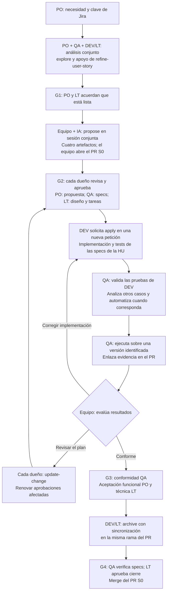

# Playbook de S0 para PO, DEV/LT y QA

Esta guía explica el trabajo diario sobre un S0 ya preparado. Para obtenerlo o
conectar código, sigue [INSTALLATION.md](INSTALLATION.md).

La fuente oficial del proceso NUAM es el playbook de Confluence:
[Versión Full](https://nuamexchange.atlassian.net/wiki/spaces/LPLTIA/pages/2725412896)
y [Versión Resumida — Uso Día a Día](https://nuamexchange.atlassian.net/wiki/spaces/LPLTIA/pages/2725380126).
Esta guía se contrastó el **2026-11-03** con Full **1.5** y Resumida **1.0**
(ambas páginas en revisión **11**). Ante una diferencia metodológica, prevalece
la versión Full; aquí se explica cómo usar las capacidades del core en ese proceso.

Los responsables y puntos de control descritos son acuerdos del equipo, aplicados
en reuniones, ramas y revisiones de PR. No añaden restricciones a las skills ni
bloqueos automáticos al agente. Los roles orientan el trabajo y no restringen quién
puede invocar una skill.

La IA analiza, redacta e implementa dentro del alcance solicitado. Las personas
definen la necesidad, resuelven decisiones de negocio y revisan los resultados.
Consulta la revisión correcta: specs vigentes, propuestas y código observado
son fuentes distintas.

<a id="skills"></a>
## 1. Elegir una skill

Estas invocaciones van en el **chat del agente**, no en PowerShell. Selecciona la
entrada del repositorio o pide leer su `SKILL.md` local. Si aparece otra versión,
consulta [Skills locales](INSTALLATION.md#local-skills). Los workflows oficiales
requieren la CLI; la comprobación de versión se establece en [AGENTS.md](AGENTS.md).
El proceso NUAM toma **1.14.3** como versión de referencia. La
[compatibilidad técnica del core](INSTALLATION.md#cli-compatibility) también
contempla 1.13.2 según la operación; no equivale a cambiar el estándar del equipo.
Leer, refinar o preparar casos desde un S0 identificado no requiere CLI.

| Tarea | Codex | Claude Code |
| --- | --- | --- |
| Verificar fuentes o solicitar adopción/integración | `$connect-project` | `/connect-project` |
| Descubrir contexto | `$project-discovery` | `/project-discovery` |
| Refinar una historia | `$refine-user-story` | `/refine-user-story` |
| Preparar casos QA | `$prepare-tests` | `/prepare-tests` |
| Generar pruebas Playwright | `$generate-playwright-tests` | `/generate-playwright-tests` |
| Revisar un PR | `$review-pr` | `/review-pr` |
| Explorar | `$openspec-explore` | `/opsx:explore` |
| Proponer | `$openspec-propose` | `/opsx:propose` |
| Implementar | `$openspec-apply-change` | `/opsx:apply` |
| Actualizar el plan | `$openspec-update-change` | `/opsx:update` |
| Sincronizar specs | `$openspec-sync-specs` | `/opsx:sync` |
| Archivar | `$openspec-archive-change` | `/opsx:archive` |

`sync` es un workflow del agente; no existe un comando de terminal `openspec sync`.

`connect-project` verifica código local, lectura remota o entradas seleccionadas del
[catálogo compartido](INSTALLATION.md#repository-catalog). El equipo mantiene
los remotos; cada persona indica su base local o rutas por componente, que se
verifican y se recuerdan cuando se solicita preparar las fuentes. Consultar
código no necesita instalar integraciones. Adoptar el S0 e integrar consumidores
usa el recorrido explícito de instalación; Discovery se inicia cuando se pide.
La CLI se selecciona por [capacidades](INSTALLATION.md#cli-compatibility).
Reconectar conserva las
revisiones; para obtener código remoto reciente pide una actualización explícita
según [la guía](INSTALLATION.md#connect-code). No se actualizan fuentes al abrir
`explore` o `propose`. Para implementar, identifica los repositorios y copias
autorizados; disponer de un inventario o un checkout no distribuye permisos.

## 2. Quién utiliza qué

| Rol o etapa | Qué consulta | Qué pide | Qué obtiene y dónde |
| --- | --- | --- | --- |
| PO/DEV/QA: acceso | Fuentes y referencias del sistema | Verificar o recordar fuentes con `connect-project` | Acceso comprobado y ubicaciones locales recordadas cuando se solicita |
| DEV/administrador: adopción | S0 y consumidores seleccionados | Adoptar S0 e instalar integraciones con `connect-project` | Identidad, registro, punteros e integraciones; diffs para revisión; Discovery si se pidió |
| PO | Necesidad original, contexto, specs y cambios relacionados | `refine-user-story` | Objetivo, alcance, criterios y dudas; por defecto en conversación |
| PO + QA + DEV/LT: planificación | Necesidad refinada, contexto y fuentes pertinentes, con G1 acordado | `openspec-explore` para analizar y `openspec-propose` en sesión conjunta | Borradores de los cuatro artefactos exigidos por el proceso NUAM: propuesta, specs delta, diseño y tareas |
| Cada dueño: revisión del plan | Artefactos existentes y nuevas decisiones | `openspec-update-change` | Ediciones de planificación confirmadas; revisión y aprobaciones afectadas en el PR |
| DEV: implementación | Cambio identificado, tareas y repositorios afectados, tras G2 | `openspec-apply-change` mediante nueva petición | Código y pruebas solicitadas en los repositorios autorizados; avance y resultados según lo ejecutado |
| DEV: revisión de PR | PR o snapshot identificado, código en su SHA y fuentes S0 pertinentes | `review-pr` | Hallazgos verificables e informes en `.local/review-pr/`; publicación sólo cuando se solicite |
| DEV: automatización de specs | Requisitos y escenarios de la HU y suite correspondiente | Solicitar sus tests; para Playwright, `generate-playwright-tests`, grupo `OpenSpec` | Scripts trazables en el proyecto de automatización identificado; la generación no los ejecuta |
| QA: validación y otros casos | HU, specs, escenarios y pruebas de DEV en su revisión correcta | Revisar cobertura y usar `prepare-tests` para analizar otros casos | Validación de cobertura, casos complementarios y dudas; automatización adicional cuando corresponda |
| QA: automatización de flujos entre HU | Casos diseñados que abarcan varias HU y proyecto de automatización identificado | `generate-playwright-tests`, grupo QA con nombre | Scripts Playwright trazables en el proyecto de automatización; sin ejecutarlos |
| QA: ejecución | Casos, versión/build, suite, entorno y datos | Solicitud de ejecutar pruebas | Resultados verificables, incluidos fallos y pendientes; conformidad QA registrada por el equipo |
| DEV/LT y QA: cierre | Diffs, resultados y deltas, tras G3 y autorización del LT | `openspec-archive-change` con sincronización; QA verifica las specs resultantes | Specs sincronizadas e historial archivado en la rama del PR; revisión G4 y merge por el equipo |

El **PO** mantiene `proposal.md`, incluida la HU y sus criterios; **QA**, las
specs; **DEV/LT**, `design.md` y `tasks.md`. Aprueban PO, QA y LT, respectivamente.
Todos aportan a la propuesta. La propiedad de los artefactos expresa la
responsabilidad metodológica, no un control de acceso implementado por OpenSpec.

## 3. De una necesidad a un cambio



Este diagrama resume el proceso de Confluence. **G1–G4 son controles humanos**:
OpenSpec no asigna aprobadores ni comprueba esas aprobaciones. El equipo registra
en el PR las decisiones, su alcance y el commit revisado. La nueva petición de
implementación posterior a `propose` sí forma parte del límite de ese workflow.
G3 contempla tareas comprobadas, cobertura validada por QA y ausencia de defectos
bloqueantes abiertos; los demás pendientes aceptados se documentan en el PR.

NUAM exige los cuatro artefactos en cada cambio, aunque el schema técnico puede
permitir omisiones según el caso. La HU formal reside en `proposal.md`; Jira
aporta la clave y el enlace al PR, sin duplicar criterios ni aprobaciones.
La integración técnica con Jira es opcional para el core: el equipo puede mantener
esa referencia sin un conector.

Cada HU tiene un cambio y un PR en el S0, abierto desde la propuesta hasta G4.
Los PR de código se enlazan desde él y siguen las reglas de sus repositorios.
En multirrepositorio, cada tarea identifica su Git; no hay distribución automática
de tareas o permisos. Ante cambios del plan, cada dueño revisa su artefacto y el
equipo renueva las aprobaciones afectadas. Un cambio archivado se conserva;
un ajuste posterior se plantea en una nueva HU y cambio.

QA participa desde el análisis y la redacción de specs. La validación de los
tests requiere que DEV los haya generado. Los cambios de artefactos también
requieren revisar la cobertura afectada.

`apply` sigue las tareas del cambio: no invoca automáticamente
`generate-playwright-tests` ni acredita cobertura por escenario. El equipo
explicita las pruebas, la suite y los destinos en las tareas y en la petición.
La skill Playwright permite specs de HU en el grupo `OpenSpec` y casos QA que
abarcan **varias HU** en un grupo con nombre; este segundo modo no cubre todos
los posibles casos complementarios de QA. Estos pueden trabajarse en la suite
correspondiente mediante una solicitud explícita. El proyecto de automatización
puede indicarse directamente o resolverse mediante `test-automation.yaml`.
La skill escribe allí, fuera del S0 y de los repositorios de producto, sin ejecutar
pruebas por defecto. Un test implementado no equivale a uno ejecutado.

Para revisar un PR identificado puedes usar `review-pr`: captura base/head y
contrasta el código con las fuentes pertinentes. Su informe no aprueba ni fusiona
el PR y no sustituye la ejecución QA ni el cierre de OpenSpec.

## 4. Cuándo interviene una persona

| Momento | Intervención | Fuente |
| --- | --- | --- |
| Escribir contexto con Discovery | Aprobar el borrador concreto y sus archivos antes de escribir | [Project Discovery](.agents/skills/project-discovery/SKILL.md#4-publica-únicamente-el-contexto-aprobado) |
| Criterios y alcance de una HU | PO conduce el análisis con QA y DEV/LT; PO y LT acuerdan G1 | Proceso oficial, E1–E2 y G1 |
| Aprobación del plan | Cada dueño revisa su artefacto y registra la aprobación del commit en el PR | Proceso oficial, G2; control humano |
| Pasar de propuesta a implementación | Nueva petición explícita después de presentar el plan | [openspec-propose](.agents/skills/openspec-propose/SKILL.md) |
| Editar planificación existente | Confirmar cada edición presentada antes de escribir | [openspec-update-change](.agents/skills/openspec-update-change/SKILL.md) |
| Ambigüedad material, bloqueo o cambio de alcance | Aclarar la decisión que impide continuar | Reglas del workflow y alcance autorizado |
| Guardar refinamiento/casos o automatizar/ejecutar tests | Solicitar la acción con destino, alcance y acceso | [refine-user-story](.agents/skills/refine-user-story/SKILL.md), [prepare-tests](.agents/skills/prepare-tests/SKILL.md) y [generate-playwright-tests](.agents/skills/generate-playwright-tests/SKILL.md) |
| Código, resultados QA, PR y merge | QA registra conformidad, PO aceptación funcional y LT aceptación técnica; cierre tras G4 | Proceso oficial, G3–G4; controles humanos |
| Sincronizar y archivar | DEV/LT solicita cierre autorizado por LT; QA verifica specs resultantes | Proceso oficial, E7; [sync](.agents/skills/openspec-sync-specs/SKILL.md) y [archive](.agents/skills/openspec-archive-change/SKILL.md) para las opciones técnicas |

Una autorización vigente no exige pedir permiso de nuevo por cada comando;
se conservan las confirmaciones específicas del método. `sync` ya solicitado no
exige otra aprobación universal. `archive` ofrece opciones cuando existen deltas,
incluso si ya están sincronizados, y pide confirmar artefactos o tareas pendientes.
Puede archivar sin sincronizar por elección expresa; si se intenta sincronizar y
falla, el archivo queda bloqueado. Sin deltas ni pendientes no hay confirmación
adicional universal.

**Cierre en el proceso NUAM:** el equipo elige sincronizar dentro de `archive`,
con artefactos y tareas completos, tras G3 y con verificación final de QA antes
de G4. La posibilidad técnica de archivar con pendientes o sin sync no acredita
ese cierre. El uso independiente de `sync` requiere autorización del LT según
Confluence. Son criterios de trabajo del equipo, no nuevos bloqueos del core.

## 5. Peticiones de ejemplo

Sustituye los corchetes. Aporta rama o revisión al consultar un cambio: `main`
puede conservar las specs anteriores mientras el cambio exista sólo en un PR.

**PO — refinar:**

```text
Lee el contexto y las specs relacionadas de este S0. Usa refine-user-story
para refinar esta necesidad: [texto]. Distingue reglas confirmadas, criterios
propuestos y dudas que tengo que resolver.
```

**Equipo — preparar el plan en sesión conjunta, tras G1:**

```text
Usa la skill oficial local openspec-propose en [S0/store y rama].
Sesión conjunta PO, QA y DEV/LT. HU [clave], necesidad acordada en G1:
[necesidad, alcance, exclusiones y criterios]. Inclúyelos en proposal.md.
Genera los cuatro artefactos, incluido design.md, como borradores para
sus dueños. Identifica repositorios afectados y pruebas de cada tarea.
```

**DEV — implementar con el plan aprobado en G2:**

```text
Implementa el cambio [change-id] usando openspec-apply-change en [S0/store],
rama [rama del PR]. Plan aprobado por sus dueños en [PR y commit].
Puedes modificar [repositorios y ramas autorizados]. Implementa las tareas
y sus pruebas. Genera los tests de requisitos y escenarios de la HU en
[suite y ruta autorizada]. Ejecuta [comprobaciones y entorno autorizados],
mantén el avance de tasks.md y comunica resultados, cobertura y pendientes.
```

**DEV — revisar un PR:**

```text
Usa la skill local review-pr para revisar [URL del PR].
El S0 es [ruta o store resuelto]. Cambio OpenSpec relacionado: [id, si existe].
Entrega los informes locales con hallazgos, pruebas y límites.
```

También puedes aportar un snapshot y código de la revisión si no hay acceso
remoto. Si no existe HU/cambio vinculado, indícalo. Desde un consumidor, resuelve
el store y pide leer `.agents/skills/review-pr/SKILL.md` de esa raíz; no es necesario
copiar la skill al código. La publicación de comentarios se solicita expresamente.

**QA — validar cobertura y preparar otros casos:**

```text
Usa prepare-tests para el cambio [change-id] en la revisión [rama o commit].
Contrasta los requisitos y escenarios con las pruebas de DEV en [suite y
revisión accesible]. Señala brechas y límites de esa revisión. Relaciona los
casos adicionales con criterios y escenarios, identifica componentes y
señala qué falta confirmar. Entrega los casos preparados, sin ejecutarlos.
```

Para automatizar o ejecutar después, indica suite, versión, entorno, datos y acceso.

**DEV — generar los scripts Playwright de una HU:**

```text
Usa generate-playwright-tests desde [S0] para [HU/cambio y revisión].
Fuente: [ruta de specs o deltas]. Proyecto de automatización: [ruta/ID].
El origen es OpenSpec. Genera los scripts y entrega su trazabilidad.
```

La skill solicita confirmar el grupo incluso si se adelantó en la petición.
Para casos QA que atraviesan varias HU, aporta los casos y el nombre del grupo.

## 6. Reconocer el resultado real

- **Caso preparado:** comprobación diseñada, sin evidencia de ejecución.
- **Test implementado:** código de test identificado; puede faltar ejecución.
- **Test ejecutado:** resultado sobre commit/build, entorno, datos y comando o
  enlace de ejecución. Se conservan fallos y omisiones.

Un `status` completo o una validación estructural no acreditan aceptación funcional.
Registra la versión de CLI junto a cada validación: sus diagnósticos pueden variar.
Archivar tampoco prueba aprobación QA, merge o despliegue. Al cerrar, indica el
estado de las specs, la operación realizada y la publicación Git pendiente.
Las comprobaciones de la plantilla se mantienen en [VALIDATION.md](VALIDATION.md).

Si cambian componentes, interfaces o infraestructura, revisa la vigencia del
contexto. Puedes pedir Discovery sólo sobre las partes afectadas, con borrador
y aprobación antes de guardar.
