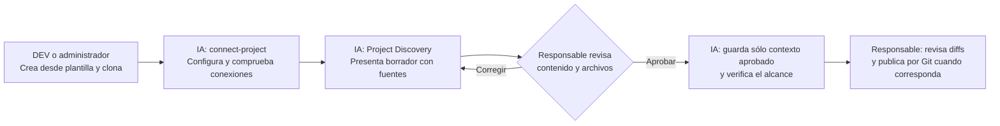
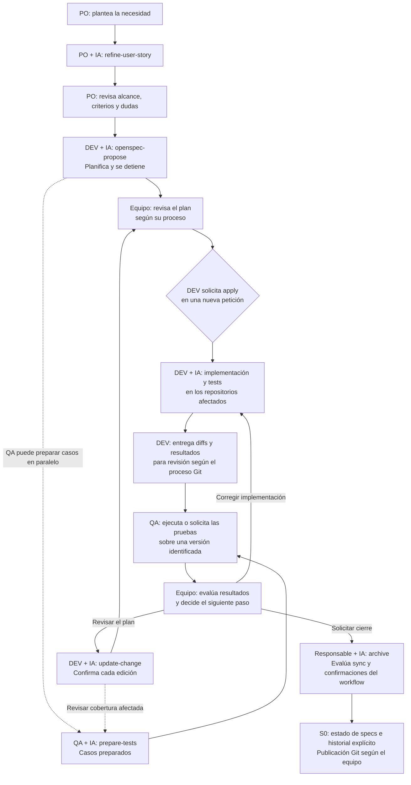

# Playbook de S0 para PO, DEV y QA

Recorrido de referencia para compartir contexto, preparar cambios y comprobar
resultados sobre el S0 de un sistema. Puede abarcar un monorepo o varios Git.
Los roles pueden recaer en las mismas personas; no se exige un archivo adicional
por rol ni una herramienta de tickets concreta. Jira es opcional.

La IA ayuda a analizar, redactar e implementar el alcance solicitado. Las
personas definen la necesidad, resuelven decisiones de negocio y revisan los
resultados. Las revisiones del equipo se ajustan a su proceso; este playbook
conserva las confirmaciones de las skills y no modifica OpenSpec.

## 1. Preparar el sistema una vez

El responsable crea y clona el S0 desde la plantilla. La [instalación](INSTALLATION.md#existing-system)
explica cómo pedir `connect-project`; después, PO y QA obtienen ese S0 ya preparado.



La aprobación de contexto antes de escribir es parte del contrato de Discovery.
`connect-project` deja cambios locales; el commit, PR y merge se hacen según el
proceso del equipo. Los demás integrantes clonan el S0 del sistema y reciben
sus instrucciones y skills. Para leer, refinar y preparar casos desde su raíz
no necesitan repetir la conexión, instalar OpenSpec ni clonar todos los servicios.

El contexto describe el sistema existente: propósito, mapa, arquitectura,
tecnologías, interfaces, infraestructura y fuentes verificables. Su organización
es opcional y se consulta selectivamente; véase [qué documenta Discovery](INSTALLATION.md#project-discovery).
Las specs vigentes, propuestas de cambio y código observado son fuentes distintas.

## 2. Quién utiliza qué

| Rol o etapa | Qué consulta | Qué pide a la IA | Qué obtiene y dónde |
| --- | --- | --- | --- |
| Responsable de adopción | S0 clonado y ubicaciones autorizadas del código | `connect-project` y borrador de `project-discovery` | Configuración local; contexto revisable y, tras aprobarlo, documentos en `context/` |
| PO | Contexto, specs vigentes, cambios relacionados y necesidad original | `refine-user-story` | Objetivo, alcance, criterios y dudas en conversación o fuente acordada |
| DEV: planificación | Necesidad refinada, contexto, specs y código pertinente | `openspec-explore` cuando haga falta y `openspec-propose` | Propuesta, specs delta, diseño y tareas en `openspec/changes/<change>/` del S0 |
| DEV: revisión del plan | Artefactos existentes y nuevas decisiones | `openspec-update-change` | Revisiones de planificación confirmadas; conserva el código |
| DEV: implementación | Cambio identificado, tareas y repositorios afectados | `openspec-apply-change` mediante una nueva petición después de la propuesta | Código y tests en los consumidores; tareas y resultados actualizados según lo ejecutado |
| QA: preparación | HDU, specs y escenarios del cambio en su revisión correcta | `prepare-tests` | Casos trazables preparados, dudas y cobertura; por defecto en conversación |
| QA: ejecución | Casos, versión/build, suite, entorno y datos disponibles | Solicitud explícita de implementar o ejecutar pruebas, cuando corresponda | Automatizaciones en la suite y evidencia de resultados, con fallos y pendientes |
| Equipo y responsable del cierre | Diffs, resultados y deltas frente a specs vigentes | `openspec-sync-specs` cuando corresponda y `openspec-archive-change` | Specs sincronizadas según la operación elegida e historial archivado, con estado de sync explícito |

Las [invocaciones Codex y Claude](README.md#trabajar-con-las-skills) van en el
chat del agente. Selecciona la skill del repositorio; una copia personal del
mismo nombre puede ser otra versión. Los workflows oficiales requieren la CLI.
Usa OpenSpec **1.14.3** y pide al agente comprobar el ejecutable efectivo cuando
haya varias instalaciones, también al empezar una sesión nueva.

## 3. De una necesidad a un cambio



La revisión funcional de criterios y la revisión del plan son recomendaciones
de trabajo del equipo; OpenSpec no asigna aprobadores PO/DEV/QA. La transición
de `propose` a `apply` sí requiere una nueva petición explícita: la propuesta
termina al presentar los artefactos y no continúa sola hacia implementación.

QA puede preparar cobertura antes de que termine el código. Si cambian los
artefactos, revisa también los casos afectados. Si cambia la intención del
cambio, el workflow puede requerir uno nuevo en vez de retocar el anterior.

En multirrepositorio, cada tarea identifica su Git. DEV implementa en las raíces
autorizadas y enlaza los PR de código con el cambio S0; el agente no distribuye
automáticamente tareas entre repositorios. QA registra qué versiones comprobó.

## 4. Cuándo interviene una persona

| Momento | Intervención | De dónde viene |
| --- | --- | --- |
| Borrador de Discovery, inicial o actualizado | Aprobar el contenido concreto y sus archivos antes de escribir | Contrato de [Project Discovery](.agents/skills/project-discovery/SKILL.md#4-publica-únicamente-el-contexto-aprobado) |
| Criterios y alcance de una HDU | PO contrasta el refinamiento con la necesidad y resuelve dudas de negocio | Revisión funcional recomendada; no es una aprobación automática de la skill |
| Paso de propuesta a implementación | Una nueva petición explícita inicia `apply` después de presentar el plan | Límite de planificación de [openspec-propose](.agents/skills/openspec-propose/SKILL.md) |
| Revisión de artefactos existentes | Confirmar cada edición presentada antes de escribir | Contrato de [openspec-update-change](.agents/skills/openspec-update-change/SKILL.md) |
| Ambigüedad material, bloqueo o cambio de alcance | Aclarar la decisión que impide continuar; no inventar reglas para desbloquear | Reglas de los workflows y alcance autorizado |
| Guardar refinamiento/casos o automatizar/ejecutar tests | Solicitar esa acción con su destino, alcance y acceso; no se deduce de preparar casos | Contratos de [refine-user-story](.agents/skills/refine-user-story/SKILL.md) y [prepare-tests](.agents/skills/prepare-tests/SKILL.md) |
| Código, resultados QA, PR y merge | Aplicar los revisores y criterios de aceptación acordados por el equipo | Proceso del equipo; las skills no imponen un aprobador universal |
| Sincronización y archivo | Resolver ambigüedades; en archivo, confirmar pendientes y elegir tratamiento de deltas cuando el workflow lo pida | Contratos de [sync](.agents/skills/openspec-sync-specs/SKILL.md) y [archive](.agents/skills/openspec-archive-change/SKILL.md) |

Una solicitud ya autorizada con alcance concreto no exige volver a pedir permiso
para cada comando. Conserva las confirmaciones específicas del workflow. `sync`
ya solicitado no tiene una aprobación humana universal adicional; `archive`
muestra opciones si hay deltas y pide confirmación si faltan artefactos o tareas.
Una sincronización fallida impide archivar el cambio.

## 5. Peticiones de ejemplo

Sustituye los textos entre corchetes. Aporta la rama o revisión cuando vayas a
revisar una propuesta; `main` puede conservar las specs anteriores mientras el
cambio sólo exista en otra rama o PR.

**PO — refinar sin crear artefactos DEV:**

```text
Lee el contexto y las specs relacionadas de este S0. Usa refine-user-story
para refinar esta necesidad: [texto]. Distingue reglas confirmadas, criterios
propuestos y dudas que tengo que resolver.
```

**DEV — preparar el plan:**

```text
Usa la skill oficial local openspec-propose para [necesidad identificada].
Consulta el contexto y el código pertinente. Identifica los repositorios
afectados y presenta los artefactos para revisión.
```

**DEV — después de recibir y revisar el plan:**

```text
Implementa el cambio [change-id] usando openspec-apply-change.
Puedes modificar [repositorios autorizados]. Ejecuta las comprobaciones
pertinentes y comunica resultados y pendientes.
```

**QA — preparar cobertura:**

```text
Usa prepare-tests para el cambio [change-id] en la revisión [rama o commit].
Relaciona los casos con criterios y escenarios, identifica componentes y
señala qué falta confirmar. Entrega los casos preparados, sin ejecutarlos.
```

Para automatizar o ejecutar después, indica por separado suite, versión, entorno,
datos y acceso disponibles. La matriz propuesta es preparación, no evidencia.

## 6. Qué comprobar antes de dar un resultado por cerrado

- **Caso preparado:** existe una comprobación diseñada, sin ejecución acreditada.
- **Test implementado:** hay código de test identificado; puede faltar ejecución.
- **Test ejecutado:** existe resultado sobre commit/build, entorno, datos y comando
  o enlace de ejecución. Se conservan también fallos y omisiones.

Un `status` completo o una validación estructural no prueban que el producto
funcione. Archivar no acredita aprobación QA, merge ni despliegue. Al cerrar,
comunica qué specs se consolidaron, qué operación se realizó y qué publicación
Git falta. Consulta [VALIDATION.md](VALIDATION.md) para las comprobaciones del core.

Cuando cambien componentes, interfaces o infraestructura, revisa también si el
contexto quedó desactualizado. Puedes pedir Discovery sólo sobre las partes
afectadas, con el mismo recorrido de borrador y aprobación antes de guardar.
