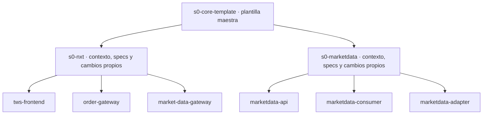

# S0 Core — plantilla para sistemas

S0 Core es una plantilla reutilizable para crear repositorios independientes de
contexto y especificaciones, basados en OpenSpec. Cada instancia representa un
sistema o proyecto, admite uno o múltiples repositorios de código y proporciona
una base común de skills para PO, DEV y QA, sin imponer procesos institucionales
adicionales.

`s0-core-template` es el repositorio maestro. Cada sistema crea su propio S0 desde
GitHub Template, con identidad OpenSpec, remoto e historial Git propios. Usa
OpenSpec nativo `spec-driven`; el código y los tests permanecen en los repositorios
de producto. Las specs de distintos sistemas no se mezclan.



Los nombres del diagrama son ejemplos de organización, no componentes descubiertos
ni repositorios creados por esta plantilla. Las flechas desde el maestro representan
la creación inicial; no una sincronización continua.

El núcleo no fija un proveedor ni un modelo. Incluye integraciones de Codex y
Claude Code para aplicar los mismos métodos y reglas; otros agentes pueden
consumir los archivos comunes cuando tengan acceso a ellos.

Versión documentada del núcleo: **0.2**. CLI comprobada: **OpenSpec 1.14.3**, con Node.js
**>=20.19.0** para la distribución npm. Stores sigue siendo beta: actualiza la
versión sólo después de repetir la validación. No necesitas Node si utilizas el
binario oficial equivalente.

## Empezar en 10 minutos

Requisitos: Git, OpenSpec 1.14.3 y un agente con acceso a la carpeta para utilizar
los workflows. Puedes iniciar Codex o Claude Code desde la raíz S0. Instalación
npm fijada si la política del equipo lo permite:

```powershell
npm install -g @fission-ai/openspec@1.14.3
openspec --version
```

Para un sistema nuevo, sigue [Crear un S0 desde la plantilla](#crear-un-s0-desde-la-plantilla).
Para incorporarte a un S0 ya adoptado, clona **su repositorio**, sin cambiar su
identidad. Sustituye la URL y el ID de ejemplo por los reales:

```powershell
git clone https://github.com/your-team/s0-my-system.git s0-my-system
cd s0-my-system
openspec store register .
openspec store list
openspec status --store my-system
openspec store doctor my-system
code .
```

El registro es local a tu máquina; no sincroniza Git. Actualiza el clon con
`git pull` antes de trabajar y comprueba rama/commit. Un ID sólo puede resolver
un checkout por registro: si ya usas ese ID, revisa `store list` antes de
registrar otro clon. No reemplaces un registro existente sin saber qué usa.

El repositorio incluye los seis workflows oficiales para ambos clientes y dos
skills propias con una única fuente funcional. Las instrucciones comunes
están en [AGENTS.md](AGENTS.md); `CLAUDE.md` importa ese archivo. Las propias se
mantienen en `.agents/skills/`; sus entradas de `.claude/skills/` sólo indican
cómo leer esa misma fuente.

Los nombres de carpetas, archivos propios, skills y claves de inventario se
escriben en inglés. La documentación y las respuestas pueden mantenerse en
español. Las skills usan verbos de acción: `refine-user-story` y `prepare-tests`;
«user story» corresponde a historia de usuario (HDU).

Abre una sesión nueva en la raíz S0 y comprueba las entradas del cliente elegido:

| Tarea | Codex | Claude Code |
| --- | --- | --- |
| Explorar | `$openspec-explore` | `/opsx:explore` |
| Proponer | `$openspec-propose` | `/opsx:propose` |
| Implementar | `$openspec-apply-change` | `/opsx:apply` |
| Actualizar el plan | `$openspec-update-change` | `/opsx:update` |
| Sincronizar specs | `$openspec-sync-specs` | `/opsx:sync` |
| Archivar | `$openspec-archive-change` | `/opsx:archive` |
| Refinar HDU | `$refine-user-story` | `/refine-user-story` |
| Preparar casos QA | `$prepare-tests` | `/prepare-tests` |

La tabla muestra las formas de invocación previstas por las integraciones.
Tener archivos instalados y comprobar su descubrimiento efectivo son pruebas
distintas; el resultado observado por cliente se registra en [VALIDATION.md](VALIDATION.md).

También puedes pedir el trabajo en lenguaje natural:

```text
Usa refine-user-story con esta necesidad: el operador debe cancelar varias órdenes.
Usa prepare-tests sobre los criterios que acabamos de acordar.
```

`propose` prepara artefactos; `apply` implementa cuando lo solicitas. Las skills
propias devuelven su resultado en conversación por defecto: refinar no
crea cambios/tickets y preparar casos no ejecuta tests ni acredita aprobación QA.
Una HDU puede ser texto; Jira requiere una conexión autorizada y es opcional.

## Contenido y responsabilidades

```text
.openspec-store/store.yaml         Identidad creada por la CLI oficial
openspec/config.yaml              Schema, contexto conciso y reglas
openspec/specs/.gitkeep            Requisitos vigentes; vacío en esta plantilla
openspec/changes/archive/.gitkeep  Cambios e historial; vacío al comenzar
context/project.md               Contexto confirmado del sistema
repositories.yaml                Inventario opcional; cada sistema puede crearlo
AGENTS.md                        Instrucciones comunes para agentes
CLAUDE.md                        Puente que importa AGENTS.md
.agents/skills/openspec-*/        Seis skills oficiales para Codex
.agents/skills/refine-user-story/ Fuente común de refinamiento PO
.agents/skills/prepare-tests/     Fuente común de preparación QA
.claude/commands/opsx/            Seis comandos oficiales generados
.claude/skills/openspec-*/        Seis skills oficiales para Claude
.claude/skills/refine-user-story/ Puente a la fuente común de PO
.claude/skills/prepare-tests/     Puente a la fuente común de QA
VALIDATION.md                     Evidencia y pendientes del piloto de la plantilla
```

Mantén una página de contexto con propósito, usuarios, alcance, vocabulario,
componentes y enlaces Git. `config.yaml` referencia esa página; el agente debe
leerla cuando corresponda, no se incrusta automáticamente. Las specs describen
comportamientos observables. No se exigen `jira.md`, `revision.md`, `qa.md`, schemas
personalizados, `.base/`, inventarios, actualizadores ni un visor.

## Crear un S0 desde la plantilla

1. En [s0-core-template](https://github.com/fdelvalle01/s0-core-template), elige
   **Use this template → Create a new repository**. Define propietario, nombre
   como `s0-my-system` y visibilidad. Usa sólo la rama predeterminada, sin
   **Include all branches**, para no copiar ramas de piloto o propuestas.
2. Clona el repositorio recién creado. GitHub inicia un historial independiente
   con el contenido de la plantilla; no es un fork. Comprueba con `git remote -v`
   que `origin` apunta al **nuevo sistema**, no al maestro.
3. Dale una identidad OpenSpec propia con la secuencia siguiente, **una sola vez
   en el clon nuevo, antes de registrarlo**. La metadata heredada contiene
   `id: s0-core`; retira únicamente ese archivo genérico y deja que la CLI lo
   regenere. No ejecutes este paso sobre el maestro ni sobre un S0 ya adoptado.

```powershell
git clone https://github.com/your-team/s0-my-system.git s0-my-system
cd s0-my-system
git remote -v
Get-Content -LiteralPath .openspec-store/store.yaml

$s0Id = 'my-system'
Remove-Item -LiteralPath .openspec-store/store.yaml
openspec store register . --id $s0Id --yes
openspec store doctor $s0Id
openspec status --store $s0Id
```

La URL y el ID son ejemplos. El ID identifica al sistema y debe coincidir en todos
sus consumidores. `register` no modifica el historial Git. En OpenSpec 1.14.3,
`register --id` **rechaza** una identidad existente distinta, incluso con `--yes`;
por eso se regenera el archivo heredado, sin editar su YAML a mano ni ejecutar
`git init`. Si falla el registro, resuelve el error antes de continuar. Si ya
registraste accidentalmente este clon como `s0-core`, revisa `store list` y
desregistra sólo esa asociación si apunta a este clon; conserva el registro del
maestro si apunta a otro checkout.

4. Sustituye `context/project.md` y adapta este README con datos confirmados:
   propósito, usuarios, límites, ID, URL del S0, componentes y fuentes canónicas.
   `openspec/config.yaml` mantiene el schema y las reglas nativas. Las specs y
   los cambios comienzan vacíos; el inventario de repositorios es opcional.
5. Las integraciones Codex/Claude ya vienen incluidas. Conserva las rutas de las
   skills y sus puentes. `VALIDATION.md` describe **pruebas de la plantilla**, no
   pruebas de tu sistema: reemplázalo por evidencia propia o retíralo y ajusta
   los enlaces del README. Registra la versión/commit del maestro utilizado.
6. Revisa el diff y publica la nueva identidad y el contexto mediante un commit
   y PR **en el repositorio del sistema**. Los siguientes integrantes clonan y
   ejecutan `openspec store register .`; no regeneran la identidad.

La función Template y el historial independiente están descritos en la
[guía oficial de GitHub](https://docs.github.com/en/repositories/creating-and-managing-repositories/creating-a-repository-from-a-template).
Para mantener el maestro, trabaja en su propio clon y PR; no añadas allí las
specs de los sistemas derivados.

## Un S0, uno o varios repositorios

Un S0 representa el **sistema o producto**, no necesariamente un microservicio.
Puede contener capacidades como `order-management`, `market-data` y `authentication`
aunque su implementación esté repartida entre quince repositorios. Cada cambio
identifica los componentes afectados y enlaza sus PR; no necesita una copia de
las specs por repositorio de código.

Para pocos componentes basta documentar nombre, responsabilidad y URL Git en
`context/project.md`. Opcionalmente, el sistema puede crear `repositories.yaml`
en la raíz del S0:

```yaml
repositories:
  - name: tws-frontend
    type: frontend
    technology: React
  - name: order-gateway
    type: backend
    technology: Java
  - name: market-data-gateway
    type: backend
    technology: Go
```

Es un ejemplo ficticio y una **extensión opcional de S0**, no configuración que
OpenSpec interprete ni un archivo distribuido por defecto. Puedes añadir `url`,
`responsibility` y, si corresponde, una referencia al S0 responsable. No incluyas
rutas personales, credenciales ni instrucciones ejecutables. El inventario ayuda
a localizar componentes; no clona repositorios ni concede acceso por sí mismo.

Si un subsistema tiene su propio S0, acuerda qué capacidades son canónicas en
cada uno. El S0 del sistema describe los contratos e integraciones que le
corresponden y referencia los requisitos internos del subsistema por URL y
revisión; evita mantener dos copias de la misma especificación. Un cambio que
afecta ambos se coordina con cambios/PR enlazados en cada S0. Si una fuente no
está accesible, registra la limitación sin inventar sus requisitos.

## Conectar uno o varios repositorios de código

Registra primero el S0 en la máquina. En la raíz Git del consumidor, crea
`openspec/config.yaml` con un único puntero (usa el ID real de tu sistema):

```yaml
store: my-system
```

Repite este puntero en cada repositorio de código del mismo sistema. Todos
resuelven el mismo S0; un repositorio de otro sistema usa su ID correspondiente.
Para los ejemplos del diagrama, los tres repositorios NXT apuntarían a `nxt` y
los tres de MarketData a `marketdata`, una vez creados y registrados esos stores.

`--profile core` selecciona los seis workflows. Comprueba la preferencia local
con `openspec config get delivery`: decide si genera skills, comandos o ambos.
Si quieres ambos como en esta plantilla, ejecuta `openspec config set delivery both`
antes de inicializar. Ese ajuste cambia la preferencia de la máquina.

Luego, siempre desde esa raíz:

```powershell
openspec init --tools claude,codex --profile core --no-animation
openspec context --json
openspec status
```

El inicializador conserva el puntero y sólo añade integraciones al consumidor.
No crees `openspec/specs/` ni `openspec/changes/` allí: tienen
precedencia sobre el puntero. Confirma que `context` resuelve la raíz del S0.

El puntero no instala las skills propias del S0 ni carga sus instrucciones en
una sesión iniciada en el código. Para PO y QA inicia la sesión en la raíz S0.
Si trabajas desde el consumidor, indica al agente que lea `AGENTS.md`, el contexto
y la skill concreta de la raíz resuelta; comprueba que puede acceder a ellos.
No presupongas que aparecen en el selector del cliente por registrar el store.

Para implementar, abre S0 y el código con acceso autorizado a ambas raíces.
Un workspace puede hacerlas visibles, pero no concede permisos. Guarda los
workspaces con rutas personales fuera del repositorio compartido. Worksets es
opcional.

## Un cambio de PO a QA

Todos trabajan sobre el Git compartido del sistema: contexto, specs vigentes y
cambios propuestos. Ningún rol necesita generar obligatoriamente un archivo
adicional por participar.

| Rol | Qué consume | Qué produce |
| --- | --- | --- |
| PO | Contexto, specs y cambios existentes | HDU en Jira u otra fuente, o refinamiento en conversación; revisión funcional en PR |
| DEV | HDU, contexto y specs | `proposal.md`, `design.md`, `tasks.md` y deltas de specs; código en sus repositorios |
| QA | HDU, specs y escenarios del cambio | Casos, automatizaciones y resultados en la suite o herramientas correspondientes |

1. **PO:** aporta la HDU en texto o mediante una fuente accesible. `refine-user-story`
   consulta el contexto y las specs y devuelve objetivo, alcance, criterios y dudas.
2. **DEV:** explora y propone. OpenSpec crea `proposal.md`, deltas en `specs/`,
   `design.md` y `tasks.md` en `openspec/changes/<change>/` del S0.
3. **Equipo:** revisa el plan en una rama `s0/<story-or-slug>` y PR. La revisión de
   documentos no acredita aceptación del software; la CLI no impone aprobadores.
4. **DEV:** solicita `apply` con código accesible y autorizado. Implementación y
   tests permanecen en los repositorios consumidores afectados, con sus PR
   enlazados al cambio del S0.
5. **QA:** `prepare-tests` deriva casos trazables. Automatizar y ejecutar es
   trabajo explícito en la suite, identificando commit/build, entorno y datos.
6. **Equipo:** revisa resultados y alcance. El workflow `sync` consolida specs
   y `archive` cierra el cambio; usa la invocación del cliente indicada en la
   tabla. La CLI `archive` también puede consolidar specs.

Usa el PR para enlazar HDU o solicitud, ID OpenSpec, PR de código y resultados de
pruebas sobre una revisión identificable. Mientras una propuesta está en una rama,
los revisores deben usar esa rama o su diff; `main` conserva lo consolidado antes.
Protección de rama, aprobaciones y merge se configuran en Git, no por estas skills.

En QA distingue **caso preparado**, **test implementado** y **test ejecutado sobre
una versión**. Mantén fallos y pendientes visibles; no marques como ejecutado lo
que sólo es una matriz o un archivo de test.

## Comprobaciones y mantenimiento

Estos comandos usan el ID de la plantilla; en una instancia utiliza su ID propio:

```powershell
openspec store list
openspec store doctor s0-core
openspec list --store s0-core
openspec list --specs --store s0-core
openspec status --store s0-core
openspec validate --all --strict --no-interactive --store s0-core
openspec doctor --store s0-core
```

Sin cambios/specs, los listados vacíos son correctos. La validación estructural no
sustituye tests de producto. No existe un comando de terminal `openspec sync`:
sync es un workflow del agente.

Las skills oficiales se mantienen con la CLI de la versión acordada. Revisa
primero `openspec update --dry-run`; al adoptar otra versión, vuelve a probar
registro, resolución store-only, generación para ambos clientes y ciclo de
cambio. No edites a mano los workflows generados.

Las instrucciones compartidas se editan en `AGENTS.md`; los métodos PO/QA se
editan sólo en sus dos fuentes de `.agents/skills/`. Mantén `CLAUDE.md` y los
wrappers propios como puentes, sin duplicar reglas. Revisa estos cambios por PR
y comprueba que los enlaces relativos resuelven después de clonar o adoptar.
Al actualizar OpenSpec, verifica también que conserva las fuentes y los puentes.

### Actualizar una instancia desde el maestro

Si adoptaste los nombres anteriores, aplica estos renombres en un PR de la
instancia y actualiza sus enlaces, configuración e invocaciones:

| Nombre anterior | Nombre actual |
| --- | --- |
| `contexto/proyecto.md` | `context/project.md` |
| `refinar-hdu` | `refine-user-story` en `.agents/skills/` y `.claude/skills/` |
| `preparar-pruebas` | `prepare-tests` en `.agents/skills/` y `.claude/skills/` |
| `repositorios.yaml`, si existe | `repositories.yaml` |
| `VALIDACION.md` | `VALIDATION.md` |

En el inventario opcional, usa `repositories`, `name`, `type`, `technology` y
`responsibility` en lugar de `repositorios`, `nombre`, `tipo`, `tecnologia` y
`responsabilidad`; `url` se conserva. Mantén los valores propios del sistema.
Las carpetas de skills se renombran junto con su campo `name` y los enlaces de
los puentes. Inicia una sesión nueva del cliente para comprobar los nombres
actuales. No se necesita crear el inventario para adoptar estos cambios.

Cada S0 evoluciona por separado. Una mejora de `s0-core-template` no llega
automáticamente a los proyectos existentes. Si quieres incorporarla, compara el
diff del maestro con la versión adoptada y prepara un PR selectivo en el S0 del
sistema, conservando sus personalizaciones. Revisa instrucciones y skills antes
de copiar cambios; no sustituyas su identidad, contexto, inventario, specs ni
historial con los de la plantilla. No hay un actualizador automático en esta
versión.

`git pull` actualiza el repositorio al que pertenece el clon; `openspec update`
regenera integraciones oficiales. Ninguno distribuye los cambios propios del
maestro a las instancias. Cambiar de modelo o de cliente tampoco crea otro S0:
los agentes leen y modifican los mismos artefactos autorizados del sistema.

## Clientes y alcance de la certificación

Codex y Claude Code cuentan con integraciones de proyecto equivalentes y
consumen las mismas fuentes compartidas. Cada cliente necesita comprobar
descubrimiento y uso en una sesión nueva, con su versión y el commit del S0.
Claude Desktop Code requiere su propia prueba. La estructura no garantiza
resultados idénticos entre modelos ni concede acceso a carpetas o conectores.

Con otro agente, pide que lea `AGENTS.md`, `context/project.md` y la skill
concreta de `.agents/skills/`. Si OpenSpec ofrece una integración oficial para
ese cliente, genérala con la CLI acordada y compruébala. La lectura explícita de
archivos no acredita descubrimiento automático; evita prometerlo universalmente.

En Cowork/Chat no se supone carga automática de las carpetas del repositorio:
empaquetado y habilitación son un piloto separado. Jira y Worksets siguen siendo
opcionales.

El [registro de validación](VALIDATION.md) distingue pruebas locales ejecutadas de
revisión humana, permisos reales y clientes pendientes. Un piloto local no implica
certificación institucional completa.

## Referencias oficiales

- [Crear y mantener un repositorio plantilla en GitHub](https://docs.github.com/en/repositories/creating-and-managing-repositories/creating-a-template-repository).
- [Crear un repositorio independiente desde una plantilla](https://docs.github.com/en/repositories/creating-and-managing-repositories/creating-a-repository-from-a-template).
- [Stores y resolución store-only](https://openspec.dev/docs/stores).
- [CLI y flags soportados](https://openspec.dev/docs/cli).
- [Perfiles y seis workflows core](https://openspec.dev/docs/profiles).
- [Configuración de proyecto](https://openspec.dev/docs/configuration/config-yaml).
- [OpenAI Docs: skills de Codex y rutas de proyecto](https://learn.chatgpt.com/docs/build-skills).
- [Claude Code: instrucciones e importación de archivos](https://code.claude.com/docs/en/memory).
- [Claude Code: skills de proyecto e invocación](https://code.claude.com/docs/en/skills).
