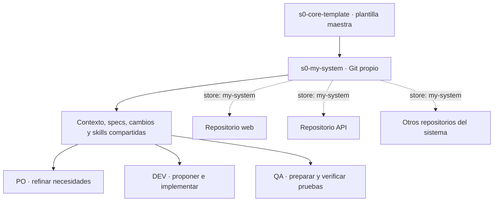

# S0 Core — plantilla para sistemas

S0 Core es una plantilla reutilizable para crear repositorios independientes de
contexto y especificaciones, basados en OpenSpec. Cada instancia representa un
sistema o proyecto, admite uno o múltiples repositorios de código y proporciona
una base común de skills para PO, DEV y QA, sin imponer procesos institucionales
adicionales.

**El equipo prepara el S0 del sistema una vez. Después, sus integrantes descargan
ese mismo repositorio con el contexto, las specs y las skills ya compartidas.**
Un sistema puede tener uno, diez o veinte repositorios de código y un único S0.

## Inicio rápido del responsable

**Crear desde plantilla → clonar y abrir el S0 → pedir `connect-project` → revisar el contexto.**

1. En [s0-core-template](https://github.com/fdelvalle01/s0-core-template), usa **Use this template → Create a new repository** para crear el S0 de tu sistema.
2. Clona **el repositorio nuevo** y abre su raíz con Codex o Claude, con acceso al código que quieres conectar.
3. Envía la petición siguiente en el chat del agente, sustituyendo los datos entre corchetes.
4. Revisa el borrador de contexto. Cuando apruebes su contenido y archivos destino, el agente lo guarda y verifica.

```text
Lee AGENTS.md y usa la skill local .agents/skills/connect-project/SKILL.md.
Este S0 corresponde a [nombre y propósito del sistema].
Puedes configurar este S0 y el código ubicado en [ruta o lista de repositorios].
Continúa con Project Discovery hasta presentar el borrador de contexto.
```

La IA comprueba la CLI, prepara identidad, registro, conexiones e integraciones
y presenta el contexto para revisar. Los cambios quedan locales; después de
revisarlos, publícalos mediante el proceso Git del equipo. Los comandos manuales
están en la [referencia avanzada](INSTALLATION.md#cli-setup).

Para continuar con historias y cambios, consulta el
[playbook de PO, DEV y QA](PLAYBOOK.md), con responsabilidades, skills y revisiones humanas.

## Empieza por tu caso

| Tu situación | Qué vas a hacer | Guía paso a paso |
| --- | --- | --- |
| Ya existe un producto, con uno o varios repositorios | Crear y clonar su S0 manualmente, pedir `connect-project` y revisar el borrador de contexto | [1. Adoptar S0 en un sistema existente](INSTALLATION.md#existing-system) |
| Vas a comenzar un proyecto sin código | Crear y clonar su S0, pedir `connect-project` sin repositorios de producto y definir el contexto inicial | [2. Empezar un proyecto nuevo](INSTALLATION.md#new-system) |
| El equipo ya preparó el S0 y te incorporas como PO, QA o lector | Clonar o descargar **el S0 del sistema**, abrirlo y usar sus archivos y skills | [3. Usar un S0 ya configurado](INSTALLATION.md#join-team) |

PO y QA pueden leer, refinar historias y preparar casos desde la carpeta S0 con
un agente compatible, **sin instalar OpenSpec ni repetir la configuración del
sistema**. La CLI es necesaria para la conexión y los workflows nativos; `connect-project` puede
instalar OpenSpec 1.14.3 si encuentra Node.js >=20.19.0 y npm. Los requisitos están en la
[guía de instalación](INSTALLATION.md#requirements).

Para comprender o actualizar un sistema ya conectado, usa
**[Project Discovery](.agents/skills/project-discovery/SKILL.md)**. Inspecciona fuentes
autorizadas, presenta contexto verificable y publica sólo el borrador aprobado
en `context/`. Es opcional; no modifica configuración, schemas, specs ni workflows
OpenSpec. El [paso de contextualización](INSTALLATION.md#project-discovery)
explica cómo invocarlo y qué comprueba.

## Qué se comparte y dónde



Los nombres son ejemplos. GitHub Template crea el repositorio independiente;
las flechas no representan sincronización automática ni clonación de código.
Cada S0 evoluciona con su propio historial. Las mejoras del maestro se adoptan
mediante un PR selectivo, conservando la identidad y el contenido del sistema.

| Archivo o carpeta | Para qué sirve |
| --- | --- |
| `context/project.md` | Propósito, usuarios, límites, mapa resumido de componentes y fuentes; índice del conocimiento del sistema |
| Otros documentos bajo `context/`, opcionales | Arquitectura, tecnologías, interfaces, infraestructura y detalle de componentes, según la evidencia y el tamaño del sistema |
| `openspec/specs/` | Especificaciones vigentes |
| `openspec/changes/` | Propuestas activas e historial archivado |
| `.openspec-store/store.yaml` | Identidad del S0, generada por la CLI oficial |
| `openspec/config.yaml` | Schema nativo `spec-driven`, contexto conciso y reglas |
| `AGENTS.md` | Instrucciones comunes para los agentes |
| `CLAUDE.md` | Referencia a esas mismas instrucciones |
| `.agents/skills/` | Workflows oficiales Codex y fuentes completas de las skills propias |
| `.agents/skills/project-discovery/scripts/` | Verificador de alcance y tests de Discovery con Git/Python |
| `.claude/skills/`, `.claude/commands/opsx/` | Integración Claude; las skills propias son puentes a las fuentes compartidas |
| `repositories.yaml`, opcional | Inventario de componentes cuando el contexto no basta; OpenSpec no lo interpreta |

El código y los tests ejecutables permanecen en sus repositorios. No se exige un
archivo adicional por rol o historia: ni `jira.md`, ni `revision.md`, ni `qa.md`.
Jira es opcional; una necesidad puede llegar como texto. Los nombres técnicos
están en inglés y la documentación puede mantenerse en español.

## Trabajar con las skills

S0 no fija un modelo ni un proveedor. Codex y Claude Code tienen entradas para
los mismos métodos; otros agentes pueden leer los archivos comunes. Abre la raíz
correcta y comprueba la ruta de la skill: una copia personal con el mismo nombre
puede coexistir con la del repositorio. Consulta
[skills locales y globales](INSTALLATION.md#local-skills) si aparece otra ruta.

Estas invocaciones se escriben **en el chat del agente, no en PowerShell**. En un
cliente con selector de skills también puedes seleccionar la entrada local.

| Tarea | Codex | Claude Code |
| --- | --- | --- |
| Conectar el proyecto | `$connect-project` | `/connect-project` |
| Descubrir contexto | `$project-discovery` | `/project-discovery` |
| Explorar | `$openspec-explore` | `/opsx:explore` |
| Proponer | `$openspec-propose` | `/opsx:propose` |
| Implementar | `$openspec-apply-change` | `/opsx:apply` |
| Actualizar el plan | `$openspec-update-change` | `/opsx:update` |
| Sincronizar specs | `$openspec-sync-specs` | `/opsx:sync` |
| Archivar | `$openspec-archive-change` | `/opsx:archive` |
| Refinar una historia | `$refine-user-story` | `/refine-user-story` |
| Preparar casos QA | `$prepare-tests` | `/prepare-tests` |

Las skills PO/QA entregan su resultado en conversación por defecto.
Refinar no crea tickets ni cambios. Preparar casos no ejecuta pruebas. El
[recorrido PO → DEV → QA](INSTALLATION.md#daily-work) explica qué sigue en cada caso.
Discovery también empieza con un borrador en conversación; la escritura posterior
está limitada a los archivos de contexto aprobados y se comprueba con Git y el
verificador incluido (Python >=3.10). Su análisis no requiere CLI OpenSpec.
`connect-project` prepara identidad, registro, punteros e integraciones y deja
los diffs locales para revisar. No hace commit, push ni PR. La escritura del
contexto continúa sujeta al borrador y las rutas aprobadas en Discovery.

## Versiones, mantenimiento y evidencia

Núcleo **0.2**, CLI comprobada **OpenSpec 1.14.3**. La instalación npm requiere
Node.js **>=20.19.0**; el binario autónomo equivalente no. Stores sigue siendo beta;
una actualización de versión necesita validar nuevamente la adopción.

- [Instalación y uso](INSTALLATION.md): tres recorridos, herramientas y soluciones a problemas habituales.
- [Playbook PO, DEV y QA](PLAYBOOK.md): qué hace cada rol, qué utiliza y cuándo interviene una persona.
- [Mantenimiento](INSTALLATION.md#maintenance): actualizar integraciones y adoptar mejoras de la plantilla.
- [VALIDATION.md](VALIDATION.md): comprobaciones reproducibles y límites de validación del core.

La validación estructural y un catálogo de skills no acreditan la ejecución de
los métodos ni la calidad semántica de sus resultados. Comprueba los clientes
que utilizará tu equipo; la regresión funcional dual sigue pendiente.
Un cambio de modelo no crea otro S0 ni garantiza resultados idénticos.
