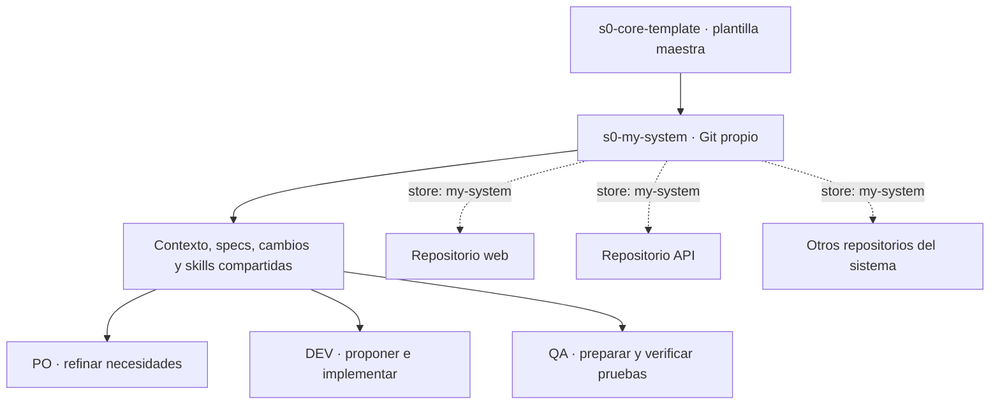

# S0 Core — plantilla para sistemas

S0 Core es una plantilla reutilizable para crear repositorios independientes de
contexto y especificaciones, basados en OpenSpec. Cada instancia representa un
sistema o proyecto, admite uno o múltiples repositorios de código y proporciona
una base común de skills para PO, DEV y QA, sin imponer procesos institucionales
adicionales.

**El equipo prepara el S0 del sistema una vez. Después, sus integrantes descargan
ese mismo repositorio con el contexto, las specs y las skills ya compartidas.**
Un sistema puede tener uno, diez o veinte repositorios de código y un único S0.

## Empieza por tu caso

| Tu situación | Qué vas a hacer | Guía paso a paso |
| --- | --- | --- |
| Ya existe un producto, con uno o varios repositorios | Crear su S0 desde la plantilla, documentar el sistema y conectar sus repositorios | [1. Adoptar S0 en un sistema existente](INSTALLATION.md#existing-system) |
| Vas a comenzar un proyecto sin código | Crear su S0, definir el contexto inicial y preparar los primeros cambios; conectar código cuando exista | [2. Empezar un proyecto nuevo](INSTALLATION.md#new-system) |
| El equipo ya preparó el S0 y te incorporas como PO, QA o lector | Clonar o descargar **el S0 del sistema**, abrirlo y usar sus archivos y skills | [3. Usar un S0 ya configurado](INSTALLATION.md#join-team) |

PO y QA pueden leer, refinar historias y preparar casos desde la carpeta S0 con
un agente compatible, **sin instalar OpenSpec ni repetir la configuración del
sistema**. La CLI se necesita para configurar el store o ejecutar workflows
nativos como `propose` y `apply`. Los requisitos completos están en la
[guía de instalación](INSTALLATION.md#requirements).

La [recapitulación de SummitApp](docs/summitapp-walkthrough.md) conserva los pasos
y comandos de nuestra primera adopción real, las correcciones de PowerShell y
los pendientes. Es un ejemplo histórico, no una instalación que debas repetir.

## Qué se comparte y dónde

Los nombres son ejemplos. GitHub Template crea el repositorio independiente;
las flechas no representan sincronización automática ni clonación de código.
Cada S0 evoluciona con su propio historial. Las mejoras del maestro se adoptan
mediante un PR selectivo, conservando la identidad y el contenido del sistema.

| Archivo o carpeta | Para qué sirve |
| --- | --- |
| `context/project.md` | Propósito, usuarios, límites, componentes y fuentes del sistema |
| `openspec/specs/` | Especificaciones vigentes |
| `openspec/changes/` | Propuestas activas e historial archivado |
| `.openspec-store/store.yaml` | Identidad del S0, generada por la CLI oficial |
| `openspec/config.yaml` | Schema nativo `spec-driven`, contexto conciso y reglas |
| `AGENTS.md` | Instrucciones comunes para los agentes |
| `CLAUDE.md` | Referencia a esas mismas instrucciones |
| `.agents/skills/` | Workflows oficiales Codex y fuentes compartidas de las dos skills propias |
| `.claude/skills/`, `.claude/commands/opsx/` | Integración Claude; las skills propias son puentes a las fuentes compartidas |
| `repositories.yaml`, opcional | Inventario de componentes cuando el contexto no basta; OpenSpec no lo interpreta |

El código y los tests ejecutables permanecen en sus repositorios. No se exige un
archivo adicional por rol o historia: ni `jira.md`, ni `revision.md`, ni `qa.md`.
Jira es opcional; una necesidad puede llegar como texto. Los nombres técnicos
están en inglés y la documentación puede mantenerse en español.

## Trabajar con las skills

S0 no fija un modelo ni un proveedor. Codex y Claude Code tienen entradas para
los mismos métodos; otros agentes pueden leer los archivos comunes. Abre la raíz
correcta y comprueba la ruta de la skill: una copia personal con el mismo nombre
puede coexistir con la del repositorio. Consulta
[skills locales y globales](INSTALLATION.md#local-skills) si aparece otra ruta.

Estas invocaciones se escriben **en el chat del agente, no en PowerShell**. En un
cliente con selector de skills también puedes seleccionar la entrada local.

| Tarea | Codex | Claude Code |
| --- | --- | --- |
| Explorar | `$openspec-explore` | `/opsx:explore` |
| Proponer | `$openspec-propose` | `/opsx:propose` |
| Implementar | `$openspec-apply-change` | `/opsx:apply` |
| Actualizar el plan | `$openspec-update-change` | `/opsx:update` |
| Sincronizar specs | `$openspec-sync-specs` | `/opsx:sync` |
| Archivar | `$openspec-archive-change` | `/opsx:archive` |
| Refinar una historia | `$refine-user-story` | `/refine-user-story` |
| Preparar casos QA | `$prepare-tests` | `/prepare-tests` |

Las dos skills propias entregan su resultado en conversación por defecto.
Refinar no crea tickets ni cambios. Preparar casos no ejecuta pruebas. El
[recorrido PO → DEV → QA](INSTALLATION.md#daily-work) explica qué sigue en cada caso.

## Versiones, mantenimiento y evidencia

Núcleo **0.2**, CLI comprobada **OpenSpec 1.14.3**. La instalación npm requiere
Node.js **>=20.19.0**; el binario autónomo equivalente no. Stores sigue siendo beta;
una actualización de versión necesita validar nuevamente la adopción.

- [Instalación y uso](INSTALLATION.md): tres recorridos, herramientas y soluciones a los problemas encontrados.
- [Mantenimiento](INSTALLATION.md#maintenance): actualizar integraciones y adoptar mejoras de la plantilla.
- [VALIDATION.md](VALIDATION.md): pruebas realizadas y pendientes de clientes y adopción.

La generación de archivos y el descubrimiento de skills se han comprobado con el
alcance indicado en ese registro. La ejecución en sesiones reales de ambos
clientes, incluido Claude Desktop Code, conserva sus comprobaciones pendientes.
Un cambio de modelo no crea otro S0 ni garantiza resultados idénticos.
